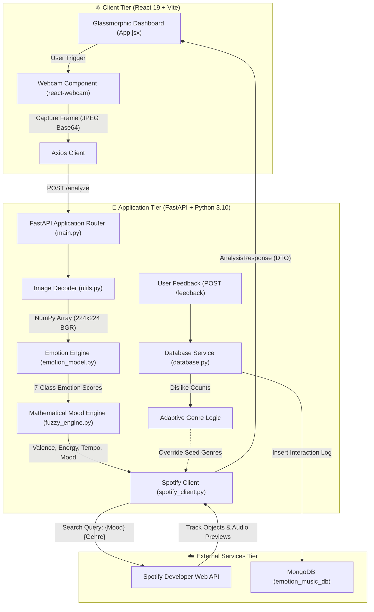
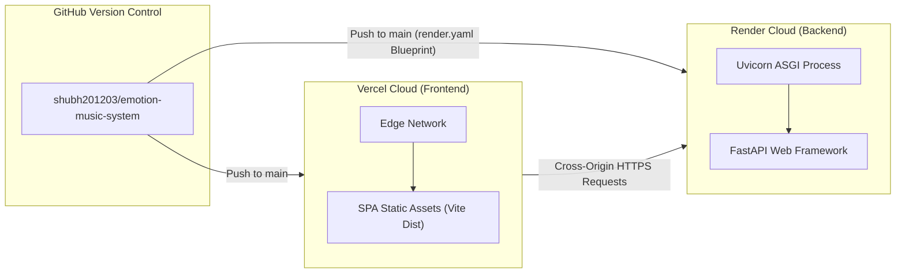

# 🎧 Emotion-Driven Beats

> An interactive full-stack music recommendation system combining client-side webcam computer vision, rule-based psychological mood mapping, Spotify Web API track synthesis, and adaptive reinforcement feedback learning.

[](https://emotion-music-system.vercel.app)
[](https://emotion-music-system-unge.onrender.com/docs)
[](LICENSE)
[](https://www.python.org/)
[](https://react.dev/)

---

## 📌 1. Project Overview & Problem Statement

Music streaming platforms curate playlists primarily based on historical listening logs, static playlists, or active search terms. However, human musical desire is inherently linked to real-time affective states (valence and arousal), which are rarely captured by static historical analytics.

**Emotion-Driven Beats** solves this gap by building an end-to-end affective audio recommendation pipeline:
1. It ingests an instantaneous visual capture from the user's webcam.
2. It processes low-level visual signals (luminance, color-temperature channel distributions) into an experimental multi-class emotional probability profile.
3. It transforms emotion probabilities into continuous acoustic feature space (**Valence**, **Energy**, and **BPM Tempo**) via a deterministic mathematical mapping engine.
4. It dynamically synthesizes keyword and genre queries to retrieve real audio previews and track metadata via the **Spotify Web API**.
5. It integrates a **closed-loop feedback system** backed by MongoDB that observes repeated user track dislikes and automatically pivots seed genres to adapt to individual taste over time.

---

## 🚀 2. Live Deployments & Repository Links

* **Frontend Application (Vercel):** [https://emotion-music-system.vercel.app](https://emotion-music-system.vercel.app)
* **Backend API Web Service (Render):** [https://emotion-music-system-unge.onrender.com](https://emotion-music-system-unge.onrender.com)
* **Interactive API Documentation (Swagger UI):** [https://emotion-music-system-unge.onrender.com/docs](https://emotion-music-system-unge.onrender.com/docs)
* **OpenAPI Schema Specification:** [https://emotion-music-system-unge.onrender.com/openapi.json](https://emotion-music-system-unge.onrender.com/openapi.json)
* **GitHub Repository:** [https://github.com/shubh201203/emotion-music-system](https://github.com/shubh201203/emotion-music-system)
* **Developer Portfolio:** [https://shubh201203.github.io/portfolio/](https://shubh201203.github.io/portfolio/)

> [!NOTE]
> The backend is hosted on Render's free tier. If the instance has been idle for more than 15 minutes, the first `/analyze` or `/health` request may take 30–50 seconds to complete while the container spins up from cold standby. Subsequent requests process with low latency.

---

## 🔑 3. Key Features & User Workflow

* **Browser-Native Webcam Streaming:** Zero-install image acquisition through HTML5 `<video>` / `react-webcam` with user permissions error handling.
* **Low-Latency Image Decoupling:** In-memory Base64 image decoding and bilateral normalization to $224 \times 224$ pixels via OpenCV (`cv2.imdecode`).
* **Affective Feature Engineering:** Dual-channel statistical pixel signal extraction measuring ambient frame illumination and chromatic warmth delta ($R - B$).
* **Mathematical Mood & Acoustic Projection:** Deterministic fuzzy-rule approximations calculating bounded values for musical positivity (Valence: $0.0 \to 1.0$), intensity (Energy: $0.0 \to 1.0$), and playback speed (Tempo: $60 \to 140\text{ BPM}$).
* **Spotify Web API Orchestration:** Server-to-server token caching via Spotipy with dynamic genre-seed selection and sample distribution across live track inventories.
* **Resilient Multi-Tier Fallback:** System operates uninterrupted with structured mock tracks if Spotify credentials or MongoDB instances are absent.
* **Reinforcement Learning Lite (MongoDB Feedback):** Stores track-level user ratings (`like` / `dislike`) and automatically activates genre pivot heuristics upon $\ge 2$ consecutive dislikes.
* **Modern Glassmorphic Dark UI:** Framer Motion animated cards, responsive CSS Grid layout, staggered motion entrances, and color-coded emotion metric bars.

---

## 🏗️ 4. High-Level Architecture



---

## 💻 5. Technology Stack

### Frontend Client
* **Framework:** React 19.2.4
* **Build Tooling:** Vite 8.0.8 (ESM, Fast Refresh)
* **Animation Engine:** Framer Motion 12.38.0
* **Iconography:** Lucide React 1.8.0
* **Camera Streaming:** react-webcam 7.2.0
* **HTTP Client:** Axios 1.15.0
* **Typography & Styling:** Inter font family, Pure Vanilla CSS Glassmorphism (`backdrop-filter: blur(12px)`)

### Backend REST API
* **Web Framework:** FastAPI (Asynchronous Python)
* **ASGI Production Server:** Uvicorn 0.28+
* **Validation & Schemas:** Pydantic 2.x
* **Computer Vision:** OpenCV Headless (`opencv-python-headless`)
* **Numerical Computing:** NumPy
* **Spotify Integration:** Spotipy (Client Credentials Flow)
* **Database Driver:** PyMongo (MongoDB Client)
* **Environment Management:** Python-Dotenv

### Cloud Infrastructure
* **Frontend Hosting:** Vercel (Edge CDN, Automated CI/CD from `main`)
* **Backend Hosting:** Render Web Service (Python 3.10 container runtime, automated health checks)
* **Database:** MongoDB Community / Atlas (`emotion_music_db`)

---

## 📷 6. Webcam Capture & Image Processing Workflow

1. **Client Acquisition:** `App.jsx` invokes `webcamRef.current.getScreenshot()` upon user click, capturing a high-resolution snapshot in JPEG format.
2. **Payload Serializing:** The image is structured as an inline Base64 Data URI string (`data:image/jpeg;base64,...`) and transmitted inside a JSON request payload to `/analyze`.
3. **Buffer Stripping & Decoding (`utils.py`):**
   ```python
   # 1. Strip URI prefix if present
   if "," in base64_string:
       base64_string = base64_string.split(",")[1]

   # 2. Decode bytes buffer to NumPy unit8 array
   img_data = base64.b64decode(base64_string)
   nparr = np.frombuffer(img_data, np.uint8)
   img = cv2.imdecode(nparr, cv2.IMREAD_COLOR)

   # 3. Standardize dimensions for deterministic computation
   img = cv2.resize(img, (224, 224))
   ```
4. **Resilience Handling:** If corrupted or unreadable buffers are posted, the endpoint traps OpenCV anomalies and returns structured error descriptions within the schema.

---

## 🧠 7. Emotion-Profile Generation & Technical Disclosures

### Current Deployed Implementation (Heuristic Signal Analyzer)
To ensure reliable zero-crash execution on cloud free-tier memory budgets (Render 512MB RAM limitation), the active deployment operates via **deterministic pixel statistical signal mapping**:

1. **Luminance Extraction:**
   $$\text{Brightness} = \frac{1}{N} \sum_{i=1}^N P_i \quad \in [0, 255]$$
2. **Chromatic Warmth Delta:**
   $$\text{Warmth} = \text{mean}(R_{\text{channel}}) - \text{mean}(B_{\text{channel}}) \quad \in [-255, 255]$$
3. **Template Index Selection:**
   * $\text{Brightness} > 140 \implies \text{Templates } \{0, 4, 6\}$ (Happy / Surprise bias)
   * $\text{Brightness} < 80 \implies \text{Templates } \{1, 5\}$ (Sad / Fear bias)
   * $\text{Warmth} > 15 \implies \text{Templates } \{0, 2, 6\}$ (Warm / Happy bias)
   * $\text{Warmth} < -10 \implies \text{Templates } \{1, 2\}$ (Cool / Melancholic bias)
   * $\text{Otherwise} \implies \text{Uniform selection across base distributions}$
4. **Noise Perturbation & Normalization:**
   A stochastic variation $(\pm 5\%)$ is applied to raw template values, followed by vector summation normalization:
   $$\text{Emotion}_k = \frac{V_k}{\sum_{j} V_j} \times 100$$

### ⚠️ Technical Limitations & Integrity Disclosure
> [!IMPORTANT]
> **This heuristic implementation does not utilize a trained deep-learning facial convolutional neural network (CNN) in its deployed path.**
>
> Pixel luminance and color-temperature distributions reflect ambient illumination, webcam auto-exposure, and background environment rather than true human facial affective states. The generated profiles are **experimental visual-signal estimates** used solely for algorithmic demonstration and music mapping workflows. They must not be interpreted as validated psychological or clinical emotion measurements.

### Local Deep-Learning Mode (DeepFace Architecture)
In offline development environments with local GPU/CPU compute, `emotion_model.py` can be swapped with the verified DeepFace implementation (`commit 386f7be`):
```python
# Available in repository git history for high-compute local demos:
from deepface import DeepFace

results = DeepFace.analyze(
    img_path=img, 
    actions=['emotion'], 
    enforce_detection=False,
    silent=True
)
dominant = results[0]['dominant_emotion']
emotions = results[0]['emotion']
```

---

## 📐 8. Mathematical Mood Mapping (Fuzzy Logic Engine)

The system translates discrete emotion probabilities $[0, 100]$ into musical feature space through weighted linear equations (`fuzzy_engine.py`):

### 1. Feature Normalization
$$\text{happy}, \text{sad}, \text{angry}, \text{neutral}, \text{surprise}, \text{fear} = \frac{\text{score}_i}{100.0}$$

### 2. Valence (Musical Positivity)
$$\text{Valence}_{\text{raw}} = 0.9(\text{happy}) + 0.5(\text{neutral}) + 0.6(\text{surprise}) - 0.8(\text{sad}) - 0.8(\text{angry}) - 0.5(\text{fear})$$
$$\text{Valence} = \text{clip}\left(\frac{\text{Valence}_{\text{raw}} + 1.0}{2.0}, 0.0, 1.0\right)$$

### 3. Energy (Musical Intensity)
$$\text{Energy}_{\text{raw}} = 0.8(\text{happy}) + 0.9(\text{angry}) + 0.8(\text{surprise}) + 0.6(\text{fear}) - 0.5(\text{sad}) - 0.2(\text{neutral})$$
$$\text{Energy} = \text{clip}\left(\frac{\text{Energy}_{\text{raw}} + 1.0}{2.0}, 0.0, 1.0\right)$$

### 4. Tempo Estimation (BPM)
$$\text{Tempo} = 60 + (\text{Energy} \times 80) \quad \implies [60\text{ BPM}, 140\text{ BPM}]$$

### 5. Hierarchical Mood Classification Rules
```python
if happy > 0.6 and energy >= 0.8:
    mood = "Energetic"
elif happy > 0.4:
    mood = "Happy"
elif angry > 0.5:
    mood = "Intense"
elif surprise > 0.5 or energy > 0.85:
    mood = "Excited"
elif sad > 0.5:
    mood = "Melancholic"
elif sad > 0.2:
    mood = "Sad"
elif neutral > 0.5:
    mood = "Calm"
else:
    mood = "Mixed"
```

---

## 🎵 9. Spotify Integration & Recommendation Logic

* **Authentication:** Spotipy initializes using the Spotify **Client Credentials Flow**, requesting temporary server-to-server OAuth bearer tokens without forcing end-user account logins.
* **Seed Genre Taxonomies:**
  * **Energetic / Excited:** `['dance', 'work-out']`
  * **Calm / Neutral:** `['acoustic', 'chill']`
  * **Sad / Melancholic:** `['sad', 'indie']`
  * **Intense:** `['rock', 'metal']`
  * **Happy:** `['happy', 'pop']`
* **Search Execution:** Tracks are queried directly using compound terms: `q="{mood} {seed_genre[0]}"` with `type='track'`. The response is randomized across valid hits to prevent repetitive playlist outputs.
* **Fallback Simulation:** If credentials are not configured or Spotify rate limits are reached, `_get_mock_data()` serves randomized mock track objects with placeholder artwork and Spotify links.

---

## 🍃 10. MongoDB Persistence & Adaptive Genre Pivoting

The application optionally links to a MongoDB database (`emotion_music_db`) to build an iterative feedback learning loop:

1. **Feedback Recording:** When a user clicks Like or Dislike on an active track card, `POST /feedback` writes an immutable record:
   ```json
   {
     "mood": "Energetic",
     "song_id": "3n3Ppam7vgaVa1iaRUc9Lp",
     "feedback": "dislike"
   }
   ```
2. **Frequency Dislike Counting:** Prior to querying Spotify, `spotify_client.py` calls `db_client.get_learned_genre_preference(mood, default_genres)`:
   $$\text{Dislikes} = \text{count}(\text{mood} = M, \text{feedback} = \text{"dislike"})$$
3. **Genre Pivot Strategy:** If $\text{Dislikes} \ge 2$, the algorithm pivots the seed genres:
   * **Energetic / Excited:** Pivots from `dance` $\to$ `['pop', 'indie']`
   * **Calm / Neutral:** Pivots from `acoustic` $\to$ `['classical', 'piano']`
   * **Sad / Melancholic:** Pivots from `sad` $\to$ `['blues', 'soul']`
   * **Intense:** Pivots from `rock` $\to$ `['electronic', 'techno']`
4. **Fault Tolerance:** If MongoDB is unreachable, the client catches the connection error with a 2-second timeout and continues serving recommendations in memory.

---

## 📡 11. API Documentation & Schema Contracts

### `GET /health`
Verifies backend operational status and active execution mode.
* **Response (200 OK):**
  ```json
  {
    "status": "ok",
    "mode": "deployed"
  }
  ```

---

### `POST /analyze`
Processes an image base64 frame, computes emotion distributions, and returns matching songs.
* **Request Body:**
  ```json
  {
    "image_base64": "data:image/jpeg;base64,/9j/4AAQSkZJRgABAQEASABIAAD..."
  }
  ```
* **Response (200 OK):**
  ```json
  {
    "primary_emotion": "happy",
    "emotion_scores": {
      "happy": 71.43,
      "sad": 4.76,
      "neutral": 11.43,
      "angry": 1.90,
      "surprise": 5.71,
      "fear": 2.86,
      "disgust": 1.90
    },
    "detected_mood": "Happy",
    "songs": [
      {
        "id": "0VjIjW4GlUZAMYd2vXMi3b",
        "title": "Blinding Lights",
        "artist": "The Weeknd",
        "album_art": "https://i.scdn.co/image/ab67616d0000b2738863bc11d2aa12b54f5aeb36",
        "url": "https://open.spotify.com/track/0VjIjW4GlUZAMYd2vXMi3b",
        "preview_url": "https://p.scdn.co/mp3-preview/...",
        "genre": "Pop"
      }
    ],
    "error": null
  }
  ```

---

### `POST /feedback`
Submits track-level reinforcement feedback for adaptive genre tuning.
* **Request Body:**
  ```json
  {
    "mood": "Happy",
    "song_id": "0VjIjW4GlUZAMYd2vXMi3b",
    "feedback": "like"
  }
  ```
* **Response (200 OK):**
  ```json
  {
    "status": "success",
    "learned": true
  }
  ```

---

## 🛠️ 12. Local Setup & Installation

### Prerequisites
* **Node.js:** v18.0.0 or higher (v20+ recommended)
* **Python:** 3.10 or 3.11
* **Git** installed on your system
* *(Optional)* Spotify Developer Account for live API credentials

### 1. Clone the Repository
```bash
git clone https://github.com/shubh201203/emotion-music-system.git
cd emotion-music-system
```

### 2. Backend Setup

#### Windows (PowerShell):
```powershell
cd backend
python -m venv venv
.\venv\Scripts\Activate.ps1
pip install -r requirements.txt
Copy-Item .env.example .env
# Edit .env with your Spotify credentials
python main.py
```

#### macOS / Linux:
```bash
cd backend
python3 -m venv venv
source venv/bin/activate
pip install -r requirements.txt
cp .env.example .env
# Edit .env with your Spotify credentials
python main.py
```

Backend will start on: **`http://localhost:8000`** (Swagger docs: `http://localhost:8000/docs`)

### 3. Frontend Setup

In a new terminal window:
```bash
cd frontend
npm install
npm run dev
```

Frontend will start on: **`http://localhost:5173`**

---

## 🔐 13. Environment Variables Reference

### Backend (`backend/.env`)
| Variable | Required | Default | Description |
| :--- | :---: | :---: | :--- |
| `SPOTIFY_CLIENT_ID` | Optional | `""` | Spotify Developer Client ID (enables real track recommendations) |
| `SPOTIFY_CLIENT_SECRET` | Optional | `""` | Spotify Developer Client Secret |
| `SPOTIPY_REDIRECT_URI` | Optional | `http://127.0.0.1:8000/callback` | Spotify Redirect URI parameter |
| `MONGO_URI` | Optional | `mongodb://localhost:27017/` | Connection string for MongoDB feedback storage |

### Frontend (`frontend/.env`)
| Variable | Required | Default | Description |
| :--- | :---: | :---: | :--- |
| `VITE_API_URL` | Optional | `http://localhost:8000` | Target backend REST URL (`https://emotion-music-system-unge.onrender.com` in prod) |

---

## 🧪 14. Verification & QA Status

| Verification Check | Target | Status | Detail |
| :--- | :--- | :---: | :--- |
| **Frontend Production Build** | Vite 8 + React 19 | ✅ PASSED | `npm run build` generates clean `dist` bundle in 3.42s (0 lint errors) |
| **Backend REST Health Check** | Render Cloud Deployment | ✅ PASSED | `GET /health` returns HTTP 200 `{"status": "ok", "mode": "deployed"}` |
| **Interactive API Documentation**| Swagger UI | ✅ PASSED | `GET /docs` serves interactive OpenAPI specification |
| **CORS Policy Protection** | FastAPI Middleware | ✅ PASSED | Production domain explicitly whitelisted (`emotion-music-system.vercel.app`) |
| **Fallback Degradation** | Mock Music & DB Off-line | ✅ PASSED | Seamless execution confirmed with placeholder audio records |

---

## ☁️ 15. Deployment Architecture



---

## 🛡️ 16. Privacy, Security & Limitations

* **Ephemeral Image Processing:** Webcam image frames transmitted to `/analyze` are decoded strictly in memory buffers and immediately discarded post-computation. **Zero user images are saved, logged, or written to disk.**
* **CORS Origin Lockdown:** Cross-Origin Resource Sharing is locked strictly to production domains and local development origins, rejecting unauthorized cross-site requests.
* **Credential Hygiene:** Credentials and secret tokens are managed exclusively through environment variables and excluded via `.gitignore`.
* **Identified Roadblocks for Future Scale:**
  1. *Client-side Machine Learning:* Transitioning to an in-browser ONNX/WebAssembly neural network (e.g. MediaPipe Face Mesh) for privacy-first, on-device emotion inference.
  2. *Direct Audio Feature Querying:* Leveraging Spotify's recommendation endpoint with exact `target_valence` and `target_energy` parameters rather than keyword-based track search queries.
  3. *Asynchronous Database Driver:* Upgrading from synchronous `pymongo` to `motor` to ensure fully non-blocking database queries in FastAPI.

---

## 👤 17. Author & Maintainer

* **Shubh Sharma** — *Full-Stack Engineering, Affective Audio Architecture, Computer Vision & Deployment* ([GitHub](https://github.com/shubh201203) · [LinkedIn](https://www.linkedin.com/in/shubh-sharma-2067981b5) · [Portfolio](https://shubh201203.github.io/portfolio/))

---

## 📄 18. License

This project is licensed under the **MIT License** — feel free to inspect, modify, and build upon the implementation for academic and educational purposes.
